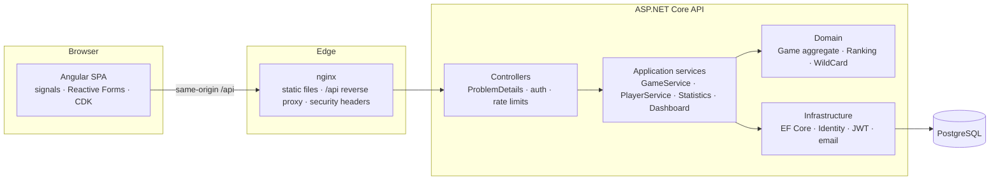
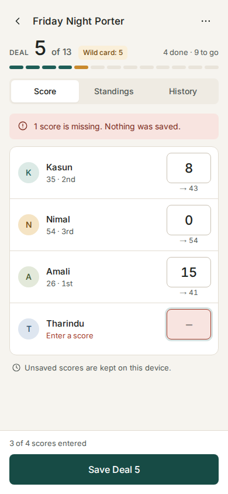
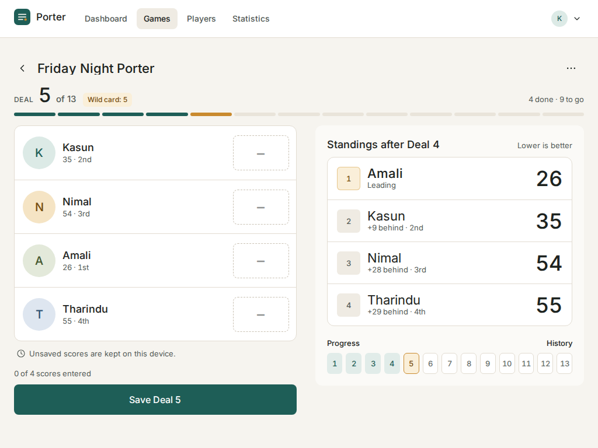
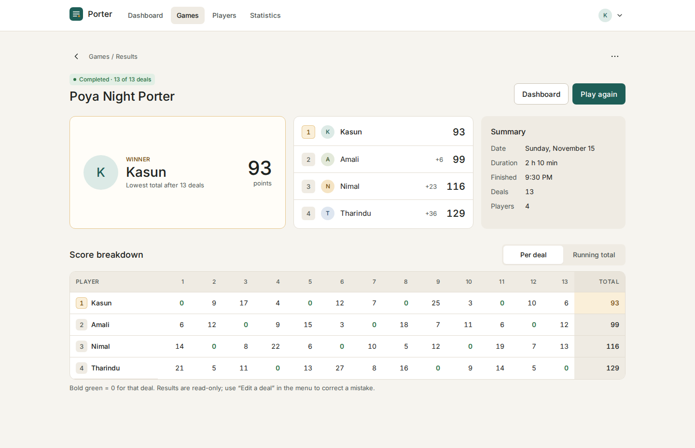

# Porter

> **The notepad, upgraded.** A scorekeeping web app for the physical Sri Lankan Porter card game.

The cards stay on the table. Porter replaces the paper score sheet. One scorekeeper creates a game, picks 2–4 players, and enters each player's score after every physical deal. Porter keeps the cumulative totals, rankings, 13-deal progress, corrections, final results, history and per-player statistics exact.

Porter is **not** a digital card game: there are no cards, decks, hands, turns or gameplay in the app.

| | |
|---|---|
| **Frontend** | Angular 22 (standalone, signals, zoneless), Reactive Forms, Angular CDK, Tailwind CSS v4 |
| **Backend** | ASP.NET Core 10 Web API (controllers), layered Clean Architecture, EF Core 10 |
| **Database** | PostgreSQL 17, EF Core migrations |
| **Auth** | ASP.NET Core Identity, JWT access tokens in memory, rotating refresh token in an HttpOnly cookie |
| **Testing** | xUnit (domain, application, API integration with Testcontainers), Vitest, Playwright |
| **Delivery** | Docker, Docker Compose, nginx, GitHub Actions |

---

## Contents

- [Features](#features)
- [Game rules implemented](#game-rules-implemented)
- [Quick start](#quick-start)
- [Development setup](#development-setup)
- [Testing](#testing)
- [Architecture](#architecture)
- [Configuration](#configuration)
- [Deployment](#deployment)
- [Project structure](#project-structure)
- [Screenshots](#screenshots)
- [Limitations and future work](#limitations-and-future-work)

## Features

- **Accounts:** register, log in, log out, forgot and reset password, change password, delete account.
- **Players:** saved identities (names, not accounts) with avatar colours. Names are unique per account, case-insensitively. A player with history can be renamed but not deleted.
- **Games:** one-screen creation with inline "add player", seat order, idempotent "Create & start", or a draft saved for setup.
- **Score entry (the core screen):** compact rows in seat order, a numeric keyboard, a live new-total preview, validation that never discards input, local draft autosave and recovery, an accessible save announcement, and conflict handling.
- **Standings:** server-calculated competition ranking (`20, 20, 25, 30 → 1, 1, 3, 4`).
- **Corrections:** any saved deal can be edited with the same form. An impact preview ("Nimal 3rd → 4th") is shown before saving. Totals and ranks are recalculated by the server.
- **Progress:** a 13-deal timeline, standings, and deal history (cards on mobile, a table on desktop).
- **Completion:** Deal 13 completes the game automatically. The results page shows the winner or joint winners, final standings, a summary, and a per-deal or running-total breakdown, plus "Play again".
- **Games list:** status filters with counts, search by game or player name, sorting and pagination, all held in the URL.
- **Statistics:** games, wins, win rate, average and best final score, finishing positions, score trend and most-played-with. Computed only from completed games.
- **Responsive:** 390px mobile with a bottom nav and sticky save bar, a two-pane tablet layout for the table, and a desktop layout with a top nav and tables.
- **Accessibility:** semantic landmarks, labelled inputs, `aria-invalid`/`aria-describedby`, live announcements, visible focus, 44px+ targets, reduced-motion support, and status shown in text as well as colour.

## Game rules implemented

These are enforced in the **Domain** layer (`server/src/Porter.Domain`) and covered by unit tests:

| Rule | Where |
|---|---|
| 2–4 distinct players, fixed seat order, locked once started | `Game.Create`, `Game.SetPlayers` |
| Exactly 13 deals, entered sequentially; Deal 13 completes the game | `Game.SaveDeal` |
| One required, non-negative integer score per player per deal; **no upper limit** | `Game.ValidateScores` |
| Lowest total wins; competition ranking; no tie-breakers | `Ranking.Rank` |
| Saved deals can be corrected (no duplicates); totals and ranks recalculate | `Game.SaveDeal` → `Deal.Correct` |
| Wild card per deal: Ace, 2–10, Jack, Queen, King (context only) | `WildCard.ForDeal` |
| No ending a game early; an active game can be deleted (soft delete) | `Game.MarkDeleted` |

The UI shows soft, non-blocking hints (an unusually high score, or no player on 0). It never blocks a valid score.

## Quick start

The quickest way to see Porter is the full Docker stack:

```bash
cp .env.example .env              # optional: adjust secrets/ports
docker compose up --build -d      # db + api + web
open http://localhost:8080        # log in as demo@porter.local / PorterDemo1
```

The demo account is seeded with the sample games from the design spec: **Friday Night Porter** (active, Deal 5 next), **Poya Night Porter** (Kasun wins with 93), **Office Lunch Porter** and **Avurudu Porter** (a two-player tie on 101).

## Development setup

**Prerequisites:** .NET SDK 10, Node.js 24 + npm, Docker.

```bash
# 1. Database (PostgreSQL on localhost:5433)
docker compose up -d db

# 2. API on http://localhost:5080. Development settings apply migrations and seed the demo account on startup.
cd server
dotnet run --project src/Porter.Api --launch-profile http
#    OpenAPI document: http://localhost:5080/openapi/v1.json  ·  Swagger UI: http://localhost:5080/swagger

# 3. Web client on http://localhost:4200 (proxies /api to :5080)
cd porter-client
npm ci
npm start
```

Migrations:

```bash
dotnet tool install -g dotnet-ef --version 10.0.15
cd server
dotnet ef migrations add <Name> -p src/Porter.Infrastructure -s src/Porter.Infrastructure -o Persistence/Migrations
dotnet ef database update      -p src/Porter.Infrastructure -s src/Porter.Infrastructure
```

The design-time factory uses `PORTER_DESIGN_CONNECTION`, falling back to the local Compose database.

## Testing

| Suite | Command | What it covers |
|---|---|---|
| Domain (xUnit) | `cd server && dotnet test tests/Porter.Domain.Tests` | 2/3/4 players, invalid counts, duplicates, sequencing, invalid deal numbers, negative/missing scores, no upper limit, totals, competition ranking and ties, completion at 13, corrections |
| Application (xUnit + Testcontainers) | `dotnet test tests/Porter.Application.Tests` | Services against real PostgreSQL: create/start/save/correct/delete, ownership, sequencing, **concurrent saves from two devices → conflict**, `xmin` concurrency, statistics computation |
| API integration (xUnit + Testcontainers) | `dotnet test tests/Porter.Api.Tests` | Full HTTP pipeline: auth (cookie flags, rotation and reuse detection, generic errors, no enumeration), validation responses, deal save/correct/complete, ties, 404 ownership, 409 conflicts, idempotent replays, players, stats, dashboard |
| Frontend unit (Vitest) | `cd porter-client && npm run test:ci` | Score-entry form (preview, validation, edit deltas), auth interceptor (refresh-and-retry, shared refresh, expiry), guards, draft storage (corruption-safe), rules helpers |
| End-to-end (Playwright) | `cd porter-client && npm run e2e` | Six core flows on desktop, two also at 390px mobile, plus draft recovery (see below) |

Backend tests need Docker (Testcontainers starts PostgreSQL). E2E needs `docker compose up -d db`. Playwright starts or reuses the API and the dev server itself.

E2E flows: (1) register → log out → log in → create players → create & start a game; (2) Deal 1 → totals and standings; (3) all 13 deals → results; (4) correct a historical deal → totals and ranks recalculate; (5) tie → joint winners and `1, 1, 3`; (6) invalid input → errors, input kept → fixed → saved.

Latest local run: **103** backend tests, **54** frontend unit tests, **9** Playwright tests, all passing.

## Architecture



- **Domain** has no framework dependencies. All scoring rules live in the `Game` aggregate.
- **Application** contains use cases and DTOs, and depends on an `IPorterDbContext` abstraction. This is a pragmatic Clean Architecture without repository boilerplate.
- **Infrastructure** implements persistence (EF Core + Npgsql), Identity, tokens and email.
- **API** is thin controllers. Exceptions are mapped to RFC 7807 Problem Details by one handler.

More detail, including the data model, auth design, the API and the decisions behind them: **[docs/architecture.md](docs/architecture.md)**. Product and UX design: **[docs/design/porter-design-spec.md](docs/design/porter-design-spec.md)**. Build plan and status: **[docs/implementation-roadmap.md](docs/implementation-roadmap.md)**.

## Configuration

API settings (environment variables use `__` for nesting):

| Setting | Purpose | Default |
|---|---|---|
| `ConnectionStrings__Postgres` | PostgreSQL connection | Dev: `localhost:5433` |
| `Jwt__SigningKey` | HMAC key for access tokens (≥ 32 chars). **Required.** | Dev-only value in `appsettings.Development.json` |
| `Jwt__AccessTokenMinutes` / `Jwt__RefreshTokenDays` | Token lifetimes | 15 / 30 |
| `App__PublicUrl` | Web app URL used in password-reset links | — |
| `Auth__SecureCookies` | `Secure` flag on the refresh cookie (true behind HTTPS) | true (false in Development) |
| `Cors__AllowedOrigins__0` | Only if the client is hosted on another origin | none |
| `RateLimiting__AuthPermitPerMinute` | Per-IP limit on login/register/reset | 10 |
| `Database__MigrateOnStartup` | Apply EF migrations at startup | false (true in Development/Compose) |
| `Seed__DemoData` | Seed the demo account | false (true in Development/Compose) |
| `Email__Smtp__Host` (+ `Port`, `Username`, `Password`, `From`, `EnableSsl`) | SMTP for reset emails. If unset, emails are **logged, not sent** | unset |
| `OpenApi__Enabled` | Expose `/openapi/v1.json` + `/swagger` outside Development | false |

Compose reads `.env` (see [`.env.example`](.env.example)). Never commit `.env`.

## Deployment

Porter ships as two containers (API and web) plus PostgreSQL. See **[docs/deployment.md](docs/deployment.md)** for a production checklist and an example layout (any container host, a managed PostgreSQL, HTTPS at the edge).

CI ([`.github/workflows/ci.yml`](.github/workflows/ci.yml)) runs on every push and PR: backend build and tests, frontend build and unit tests, Playwright E2E against PostgreSQL, and Docker image builds.

## Project structure

```
server/                         ASP.NET Core solution (Porter.sln)
  src/Porter.Domain/            entities, rules, ranking (no dependencies)
  src/Porter.Application/       use-case services, DTOs, abstractions
  src/Porter.Infrastructure/    EF Core, migrations, Identity, JWT, email, dev seeder
  src/Porter.Api/               controllers, auth, ProblemDetails, rate limiting, health
  tests/                        Domain, Application and Api test projects
porter-client/                  Angular app
  src/app/core/                 API client, auth, interceptors, guards, toasts, drafts
  src/app/shared/               reusable UI (avatars, ranks, progress, standings, states)
  src/app/layout/               app shell (top nav / bottom nav)
  src/app/features/             auth, dashboard, games (play, edit, progress, results…), players, statistics, account
  e2e/                          Playwright tests
docs/                           design spec, architecture, deployment, roadmap
docker-compose.yml              db (+ api + web)
```

## Screenshots

Captured from the running app with the seeded demo data. To regenerate, log in as the demo user at 390px, 1024px and 1440px.

| Mobile: score entry | Tablet: on the table | Desktop: results |
|---|---|---|
|  |  |  |

## Limitations and future work

What's honestly **not** done yet:

- **Email delivery** needs an SMTP server. Without one, reset links are written to the API log (fine for local use, not for production).
- **No real-time sync.** Other devices see changes on reload. Concurrent edits are detected (409) and never silently overwritten.
- **No audit log** of score corrections yet. Deals record `UpdatedAt` and `UpdatedByUserId`, and the UI marks edited deals.
- **No offline saving.** Offline, typed scores persist locally as drafts and save once the connection is back.
- The 2–4-participants rule is enforced in the domain and API, not by a database constraint, since a cross-row count isn't expressible as a simple CHECK.
- Planned: SignalR live standings and read-only spectator links, a correction audit trail, CSV/PDF export, and a dark theme.
