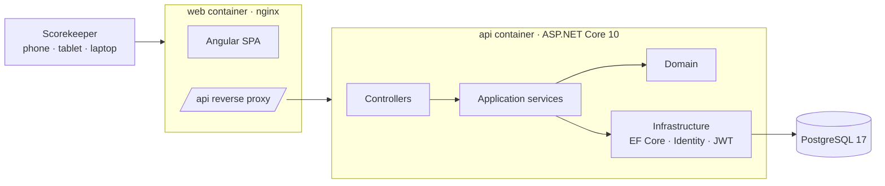
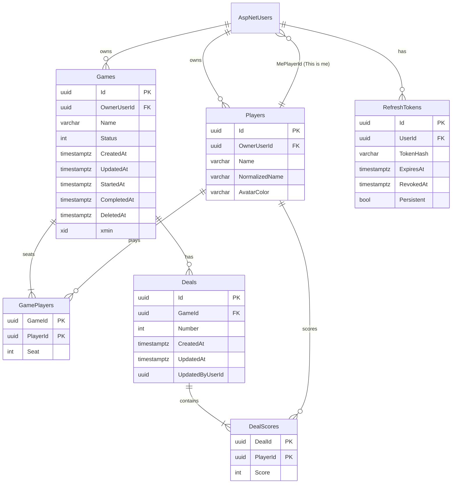
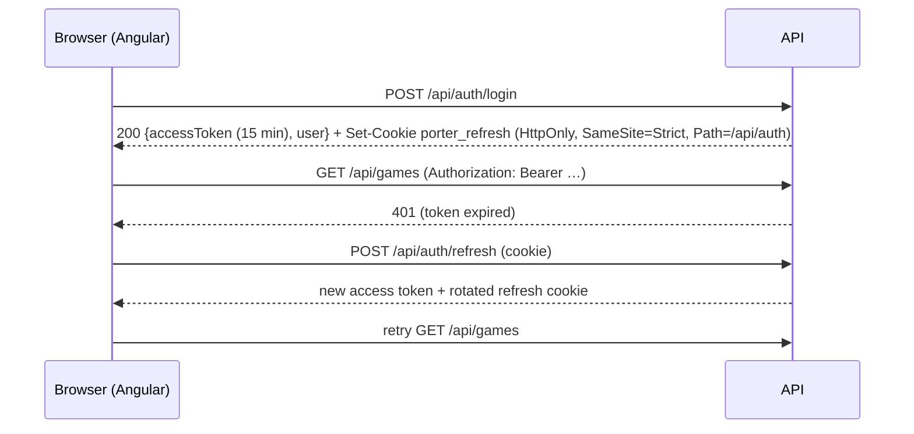

# Porter: Architecture

This document explains how Porter is built and why. Product and UX decisions are in [design/porter-design-spec.md](design/porter-design-spec.md).

## 1. System overview



The browser only ever talks to one origin. nginx serves the SPA and proxies `/api` to the API, which lets the refresh cookie be `SameSite=Strict` and removes the need for CORS in the default deployment.

## 2. Backend layers

| Project | Responsibility | Depends on |
|---|---|---|
| `Porter.Domain` | `Game` aggregate (players, deals, status), `Deal`/`DealScore`, `Player`, `Ranking`, `WildCard`, `GameRules`, `DomainException` | nothing |
| `Porter.Application` | Use cases (`GameService`, `PlayerService`, `StatisticsService`, `DashboardService`), DTOs, abstractions (`IPorterDbContext`, `ICurrentUser`, `IUserDirectory`, `IAuthService`) | Domain, EF Core (abstractions only) |
| `Porter.Infrastructure` | `PorterDbContext` (+ Identity), entity configurations, migrations, `AuthService`, `AccountService`, `TokenService`, email senders, dev seeder | Application, Npgsql, Identity |
| `Porter.Api` | Controllers, JWT bearer auth, fallback authorization policy, rate limiting, ProblemDetails exception handler, health checks, OpenAPI | Infrastructure |

**Why the Application layer uses DbSets directly:** a repository per entity would mostly forward to EF. Exposing `DbSet<T>` through `IPorterDbContext` keeps queries readable (projections, `Include`, paging) while the business rules stay in the Domain. Tests exercise the services against a real PostgreSQL.

### Request flow: saving a deal

```mermaid
sequenceDiagram
  participant UI as ScoreEntryForm (Angular)
  participant API as GamesController
  participant S as GameService
  participant G as Game (Domain)
  participant DB as PostgreSQL
  UI->>API: PUT /api/games/{id}/deals/5 {scores, expectedVersion}
  API->>S: SaveDealAsync
  S->>DB: load game (+players, deals, scores) WHERE owner = caller
  S->>S: identical replay? → return "unchanged"
  S->>S: expectedVersion ≠ xmin → 409
  S->>G: SaveDeal(5, scores, user, now)
  G->>G: validate status, number, participants, scores ≥ 0<br/>create (must be next) or correct; complete at 13
  S->>DB: SaveChanges (single transaction, UPDATE … WHERE xmin = @original)
  DB-->>S: new xmin
  S-->>API: GameStateDto (totals, standings, deals, version)
  API-->>UI: 200 {game, outcome}
```

### Error mapping

One `IExceptionHandler` turns exceptions into RFC 7807 responses:

| Exception | Status | Body |
|---|---|---|
| `RequestValidationException`, field-level `DomainException` | 400 | `ValidationProblemDetails` with `errors["scores[2].score"]` and a `code` |
| State `DomainException` (`game.not_started`, `deal.out_of_sequence`, `game.completed`, `game.not_draft`) | 409 | `ProblemDetails` + `code` |
| `ConflictException` (`game.version_conflict`, `player.duplicate_name`, `player.has_games`) | 409 | `ProblemDetails` + `code` |
| `NotFoundException` (including another user's resources) | 404 | No information about other accounts |
| Anything else | 500 | Generic message; details only in server logs |

Model-binding errors are normalised to the same camelCase paths the Angular form uses, so server errors land on the right score row.

## 3. Data model



Constraints enforced by PostgreSQL:

- `UNIQUE (GameId, PlayerId)` (primary key): a player has one seat per game.
- `UNIQUE (GameId, Seat) DEFERRABLE INITIALLY DEFERRED`: deferred so seats can be swapped in one transaction during setup.
- `CHECK (Seat BETWEEN 1 AND 4)`, `CHECK (Number BETWEEN 1 AND 13)`, `CHECK (Score >= 0)`, `CHECK (Status IN (0,1,2))`.
- `UNIQUE (GameId, Number)`: no duplicate deals, even under a race.
- `UNIQUE (OwnerUserId, NormalizedName)`: case-insensitive unique player names per account.
- Players referenced by games use `NO ACTION` deletes, so history can't be orphaned. The API returns 409 instead.

Totals and standings are **computed**, not stored. A game has at most 13 × 4 scores, so a `SUM` is trivial and nothing can drift out of sync after a correction.

Soft delete: `Games.DeletedAt` plus a global query filter. Deleted games vanish from every query, but their rows (and the players they reference) remain.

## 4. Concurrency and idempotency

| Concern | Mechanism |
|---|---|
| Two devices save different scores for the same deal | Client sends `expectedVersion` (the game's `xmin`). A mismatch returns 409 `game.version_conflict`, and the UI keeps the typed scores and offers "Load latest" / "Compare & use mine". |
| A race between two in-flight requests | EF Core's `xmin` concurrency token on the `Games` UPDATE, plus `UNIQUE (GameId, Number)`. Both surface as 409. |
| A lost response, then a retry | `PUT` is idempotent: an identical replay returns 200 `unchanged` even though the version moved on. |
| Retrying "Create game" | The client generates the game id once per form. A replay returns 200 with the existing game. |
| Double-tapping Save | The button is disabled and inputs are read-only while saving. |

## 5. Authentication and security



- **Passwords:** ASP.NET Core Identity hashing (PBKDF2). Policy is ≥ 8 characters with a letter and a digit. Lockout after 5 failures for 5 minutes.
- **Access tokens:** HS256 JWT, 15 minutes, held only in memory (never in `localStorage`).
- **Refresh tokens:** 32 random bytes, stored only as SHA-256 hashes, and rotated on every use. Re-presenting a rotated token revokes all of that user's sessions (theft detection). Logout and password reset revoke tokens. "Keep me logged in" switches between a persistent cookie and a session cookie.
- **Cookie:** `HttpOnly`, `SameSite=Strict`, `Path=/api/auth`, `Secure` outside Development. Same-origin serving plus SameSite=Strict mitigates CSRF on the refresh endpoint.
- **No enumeration:** login returns one generic 401. Forgot-password always returns 202. Another user's game or player is a 404.
- **Rate limiting:** a fixed window per IP on `/api/auth/*` (default 10/min, 60/min for refresh), returning a 429 ProblemDetails.
- **Authorization:** the fallback policy requires an authenticated user everywhere except `[AllowAnonymous]` auth and health endpoints. Every query filters by `OwnerUserId`.
- **Web hardening (nginx):** CSP (`script-src 'self'`), `X-Frame-Options: DENY`, `nosniff`, `Referrer-Policy` and `Permissions-Policy`. Critical-CSS inlining is disabled so the strict CSP needs no `unsafe-inline` scripts.
- **Session expiry in the UI:** the interceptor refreshes once (shared across concurrent 401s) and retries. If refresh fails, the user is sent to `/login?returnUrl=…&reason=expired`. Unsaved scores survive as local drafts.

## 6. Frontend architecture

```
core/      PorterApi (typed HttpClient), AuthService (signals), authInterceptor, guards,
           ToastService (+ LiveAnnouncer), DraftService, ConfirmService, Connectivity/WakeLock
shared/    Avatar, AvatarGroup, RankMarker, StatusBadge, DealProgress, DealTimeline,
           StandingsList, EmptyState, ErrorState, Skeleton, ConfirmDialog, Icon/Logo
layout/    Shell: top nav ≥768px, bottom nav <768px, hidden on focus routes
features/  auth · dashboard · games (list, create, setup, play, progress, deal detail,
           edit deal, results) · players · statistics · account · errors
```

- **Routing:** lazy-loaded feature routes with component input binding (`withComponentInputBinding`, params inherited). `/games/:id` resolves by status to setup, play or results. Edit Deal uses a `canDeactivate` unsaved-changes guard and a `beforeunload` handler.
- **State:** `GameStore` (signals) is provided at the `games/:id` route, so play → progress → edit → results share one copy of the game. Every write replaces the state with the server response.
- **Score entry:** `ScoreEntryForm` is one `FormArray` with rows in seat order, used in both `play` and `edit` mode. It handles format errors live, flags missing scores only after a save attempt, shows the new-total preview, soft warnings, and select-all on focus. The keyboard's Next key moves focus only when pressed.
- **Drafts:** values autosave (debounced) to `localStorage` under `porter:draft:{gameId}:{dealNumber}`, are restored with a notice, cleared on save, and validated on load (corrupted or mismatched drafts are discarded).
- **Styling:** Tailwind v4 `@theme` tokens map 1:1 to the design spec. A small components layer covers buttons, inputs, score inputs, badges, rank markers, deal progress and tables. Dialogs use the CDK and become bottom sheets under 768px.

## 7. Observability and operations

- Structured JSON console logs outside Development. Domain events are logged at Information (game created/started/deleted, deal saved/corrected), rejected requests at Information, and unhandled exceptions at Error.
- `GET /health/live` (process) and `GET /health/ready` (database) are used by the Docker health checks.
- Migrations run at startup when `Database__MigrateOnStartup=true` (Compose and dev), or explicitly as a deployment step (see [deployment.md](deployment.md)).

## 8. Designed for later

- **SignalR live updates:** `GameService.SaveDealAsync` is the single write path for scores. Broadcasting the returned `GameStateDto` to a per-game group is a local change.
- **Read-only spectator links:** add `Game.ShareToken` and an anonymous read endpoint returning the same `GameStateDto`. The UI components already render read-only state.
- **Correction audit log:** a `DealScoreAudit` row can be written in the same transaction where `Deal.Correct` detects changes.
- **Export:** `GameStateDto` already contains everything a CSV or PDF score sheet needs.
